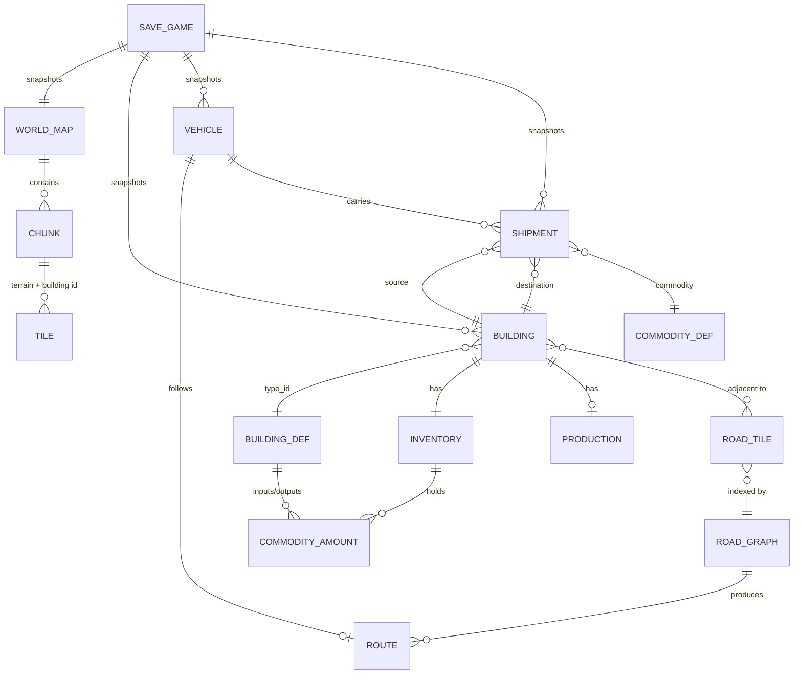

# Phase 1 Data Model: Workspace Foundation & Vertical Slice

**Feature**: `001-workspace-vertical-slice` | **Date**: 2026-11-01

Entities are grouped by owning crate. "Component" means a Bevy ECS component (plain data, no
behavior); "Resource" means a Bevy ECS resource; "Value" means a plain struct stored inside
another entity or resource. Behavior lives in systems, never in these types
(Constitution Principle III).

---

## 1. Core primitives (`metropolis_core`)

### `TileCoord` — Value

| Field | Type | Notes |
|-------|------|-------|
| `x` | `i32` | grid column |
| `y` | `i32` | grid row |

**Validation**: `0 <= x < MAP_WIDTH` and `0 <= y < MAP_HEIGHT` for any tile that exists in the
world. Out-of-range coordinates are rejected by `WorldMap::tile()` returning `None`.

### `ChunkCoord` — Value

| Field | Type | Notes |
|-------|------|-------|
| `x` | `i32` | `tile.x / CHUNK_SIZE` |
| `y` | `i32` | `tile.y / CHUNK_SIZE` |

### `BuildingId` / `VehicleId` / `ShipmentId` — Value

Newtype over `u32`. `0` is reserved as "none". Ids are allocated monotonically from a
`NextId` resource and are stable across save/load.

### `SimClock` — Resource

| Field | Type | Notes |
|-------|------|-------|
| `tick` | `u64` | fixed-tick counter, 100 ms per tick |
| `game_minute` | `u64` | `tick / TICKS_PER_GAME_MINUTE` (60) |
| `game_hour` | `u64` | `game_minute / 60` |
| `game_day` | `u64` | `game_hour / 24` |

**State transitions**: advanced only by the `advance_clock` system, which is ordered first in
`FixedUpdate`. No other system may mutate it.

### `RngStreams` — Resource

| Field | Type | Notes |
|-------|------|-------|
| `seed` | `u64` | world seed |
| `terrain` | `ChaCha8Rng` | seeded `seed ^ 0x01` |
| `logistics` | `ChaCha8Rng` | seeded `seed ^ 0x02` |
| `traffic` | `ChaCha8Rng` | seeded `seed ^ 0x03` |

**Validation**: constructed only via `RngStreams::from_seed(seed)`. No system may call
`rand::thread_rng` (Constitution Principle II).

### `SimEvent` — Value (buffered)

Enum of domain events emitted during a tick and drained by consumers:
`BuildingPlaced`, `BuildingRemoved`, `RoadAdded`, `RoadRemoved`, `ShipmentCreated`,
`ShipmentDelivered`, `ShipmentFailed`, `ProductionCompleted`.

---

## 2. World (`metropolis_world`)

### `WorldMap` — Resource

| Field | Type | Notes |
|-------|------|-------|
| `width` | `u32` | 512 |
| `height` | `u32` | 512 |
| `chunks` | `Vec<Chunk>` | row-major, `(height / CHUNK_SIZE) * (width / CHUNK_SIZE)` = 256 entries |
| `seed` | `u64` | terrain generation seed |

**Validation**: `width` and `height` MUST be multiples of `CHUNK_SIZE` (32).

### `Chunk` — Value

| Field | Type | Notes |
|-------|------|-------|
| `coord` | `ChunkCoord` | chunk position |
| `terrain` | `Vec<u16>` | `CHUNK_SIZE * CHUNK_SIZE` = 1024 entries, row-major |
| `buildings` | `Vec<u32>` | 1024 entries; `0` = empty, otherwise `BuildingId` |

**Validation**: both vectors MUST have exactly `CHUNK_SIZE * CHUNK_SIZE` elements. Contiguous
storage is required by Constitution Principle III.

### `TerrainKind` — Value (enum)

`Grass`, `Water`, `Rock`, `Sand`. Stored as `u16` in `Chunk::terrain`.

**Rules**: `Water` is not buildable and not road-buildable (FR-007).

### `PlacementRequest` — Value

| Field | Type | Notes |
|-------|------|-------|
| `building_type` | `BuildingTypeId` | index into the building catalog |
| `origin` | `TileCoord` | top-left of the footprint in grid space |
| `rotation` | `Rotation` | `North`, `East`, `South`, `West` |

### `PlacementError` — Value (enum)

`OutOfBounds`, `Occupied`, `Water`, `NoRoadAccess`, `UnknownBuildingType`.

**Validation rules** (FR-006, FR-007):
1. Every tile of the rotated footprint MUST be inside the map → else `OutOfBounds`.
2. Every tile MUST have terrain != `Water` → else `Water`.
3. Every tile MUST have `Chunk::buildings[i] == 0` → else `Occupied`.
4. The building type MUST exist in the catalog → else `UnknownBuildingType`.

Rotation transforms the footprint `(w, h)` to `(h, w)` for `East`/`West`.

---

## 3. Buildings (`metropolis_world` + `metropolis_economy`)

### `Building` — Component

| Field | Type | Notes |
|-------|------|-------|
| `id` | `BuildingId` | stable id |
| `type_id` | `BuildingTypeId` | catalog index |
| `origin` | `TileCoord` | footprint origin |
| `rotation` | `Rotation` | orientation |
| `level` | `u8` | 1 for the slice |

### `BuildingDef` — Value (loaded from `data/buildings/*.ron`)

| Field | Type | Notes |
|-------|------|-------|
| `id` | `String` | e.g. `"farm"` |
| `display_name` | `String` | UI label |
| `footprint` | `(u8, u8)` | tiles, e.g. `(3, 3)` |
| `cost` | `u32` | reserved for later economy |
| `inputs` | `Vec<CommodityAmount>` | consumed per production cycle |
| `outputs` | `Vec<CommodityAmount>` | produced per production cycle |
| `production_interval_minutes` | `u32` | game minutes per cycle; `0` = no production |
| `storage_capacity` | `u32` | total units across all commodities |
| `requires_road` | `bool` | must be adjacent to a road tile |

### `Production` — Component

| Field | Type | Notes |
|-------|------|-------|
| `progress_ticks` | `u32` | ticks accumulated toward the current cycle |
| `interval_ticks` | `u32` | `production_interval_minutes * TICKS_PER_GAME_MINUTE` |
| `active` | `bool` | false when inputs are missing |

**State transitions**:
- `Idle → Producing`: inputs present in inventory at the start of a cycle; inputs are reserved
  (removed from available stock) and `progress_ticks` resets to 0.
- `Producing → Idle (completed)`: `progress_ticks >= interval_ticks`; outputs are added to
  inventory; a `ProductionCompleted` event is emitted.
- `Producing → Idle (aborted)`: never aborted mid-cycle in the slice; inputs stay reserved.

**Rule (FR-010)**: a building MUST NOT produce output unless its required inputs are present in
inventory. This is what makes the bakery wait for flour.

---

## 4. Road network (`metropolis_transport`)

### `RoadTile` — Component

| Field | Type | Notes |
|-------|------|-------|
| `coord` | `TileCoord` | tile position |
| `connections` | `u8` | bitmask of `N=1, E=2, S=4, W=8` |

**Validation**: `connections` MUST be recomputed from neighbouring `RoadTile` entities whenever
a road is added or removed, so the mask always reflects the actual network (FR-008).

### `RoadGraph` — Resource

| Field | Type | Notes |
|-------|------|-------|
| `nodes` | `HashMap<TileCoord, u8>` | tile → connection bitmask |
| `version` | `u64` | incremented on every add/remove |

**Validation**: `version` is the cache-invalidation key. Any cached route whose
`graph_version` differs from the current `version` MUST be discarded.

### `Route` — Value

| Field | Type | Notes |
|-------|------|-------|
| `tiles` | `Vec<TileCoord>` | ordered path, source first, destination last |
| `graph_version` | `u64` | version at computation time |

### `RouteCache` — Resource

| Field | Type | Notes |
|-------|------|-------|
| `entries` | `HashMap<(TileCoord, TileCoord), Route>` | keyed by endpoints |

**Rule**: entries are dropped wholesale when `RoadGraph::version` changes (simplest correct
invalidation; the slice's graph is small).

### `RoutingError` — Value (enum)

`NoPath`, `SourceNotOnRoad`, `DestinationNotOnRoad`.

---

## 5. Vehicles (`metropolis_transport`)

### `Vehicle` — Component

| Field | Type | Notes |
|-------|------|-------|
| `id` | `VehicleId` | stable id |
| `kind` | `VehicleKind` | `Truck` for the slice |
| `capacity` | `u32` | units |
| `cargo` | `Vec<CommodityAmount>` | current load |
| `state` | `VehicleState` | see below |
| `route` | `Option<Route>` | current path |
| `route_index` | `usize` | index of the next tile |
| `progress` | `f32` | 0.0–1.0 between `route[route_index-1]` and `route[route_index]` |
| `speed_tiles_per_tick` | `f32` | movement rate |

### `VehicleState` — Value (enum)

`Idle`, `ToPickup`, `Loading`, `ToDelivery`, `Unloading`, `Blocked`.

**State transitions**:
- `Idle → ToPickup`: a shipment is assigned and a route to the source exists.
- `ToPickup → Loading`: vehicle reaches the source tile.
- `Loading → ToDelivery`: cargo transferred from source inventory (bounded by capacity).
- `ToDelivery → Unloading`: vehicle reaches the destination tile.
- `Unloading → Idle`: cargo transferred to destination inventory; `ShipmentDelivered` emitted.
- `* → Blocked`: route becomes invalid (graph version changed and no path exists). Emits
  `ShipmentFailed`; the shipment returns to the pending pool.
- `Blocked → Idle`: on the next dispatch pass.

**Rule (FR-009)**: movement advances only in `FixedUpdate` at 10 Hz, by
`speed_tiles_per_tick` per tick. No render-delta movement.

---

## 6. Commodities and economy (`metropolis_economy`)

### `CommodityDef` — Value (loaded from `data/commodities/*.ron`)

| Field | Type | Notes |
|-------|------|-------|
| `id` | `String` | e.g. `"grain"` |
| `display_name` | `String` | UI label |
| `base_value` | `u32` | reserved for later economy |

### `CommodityAmount` — Value

| Field | Type | Notes |
|-------|------|-------|
| `commodity` | `CommodityId` | catalog index |
| `amount` | `u32` | units |

### `IndustryDef` — Value (loaded from `data/industries/*.ron`)

| Field | Type | Notes |
|-------|------|-------|
| `id` | `String` | e.g. `"grain_flour"` |
| `building_type` | `String` | which building runs it |
| `inputs` | `Vec<CommodityAmount>` | per cycle |
| `outputs` | `Vec<CommodityAmount>` | per cycle |
| `interval_minutes` | `u32` | per cycle |

### `Catalog` — Resource

| Field | Type | Notes |
|-------|------|-------|
| `buildings` | `Vec<BuildingDef>` | index = `BuildingTypeId` |
| `commodities` | `Vec<CommodityDef>` | index = `CommodityId` |
| `industries` | `Vec<IndustryDef>` | |
| `vehicles` | `Vec<VehicleDef>` | |

**Validation** (run at load, fail fast): unique `id` strings; every `CommodityAmount.commodity`
resolves; every `IndustryDef.building_type` resolves; `footprint` components > 0;
`storage_capacity` > 0; `production_interval_minutes` > 0 when `outputs` is non-empty.

---

## 7. Inventory and logistics (`metropolis_logistics`)

### `Inventory` — Component

| Field | Type | Notes |
|-------|------|-------|
| `items` | `Vec<CommodityAmount>` | sparse; absent = 0 |
| `capacity` | `u32` | total units |

**Validation**: `sum(items.amount) <= capacity`. `add()` returns the amount actually accepted;
`remove()` returns the amount actually removed. Partial transfers are legal.

### `Shipment` — Component

| Field | Type | Notes |
|-------|------|-------|
| `id` | `ShipmentId` | stable id |
| `commodity` | `CommodityId` | |
| `amount` | `u32` | requested units |
| `source` | `BuildingId` | pickup building |
| `destination` | `BuildingId` | delivery building |
| `state` | `ShipmentState` | see below |
| `assigned_vehicle` | `Option<VehicleId>` | |

### `ShipmentState` — Value (enum)

`Pending`, `Assigned`, `InTransit`, `Delivered`, `Failed`.

**State transitions**:
- `Pending → Assigned`: dispatch pass (1 Hz) finds an idle vehicle and a valid route.
- `Assigned → InTransit`: vehicle finishes loading.
- `InTransit → Delivered`: vehicle finishes unloading; destination inventory increased.
- `InTransit → Failed`: route invalidated mid-trip (road removed) → `ShipmentFailed`; cargo
  returns to the source inventory.
- `Failed → Pending`: retried on the next dispatch pass if a route now exists.

**Rule (FR-011)**: dispatch MUST NOT assign a shipment when no valid route exists; the shipment
stays `Pending` and no vehicle is consumed.

### `DispatchQueue` — Resource

| Field | Type | Notes |
|-------|------|-------|
| `pending` | `Vec<ShipmentId>` | FIFO of shipments awaiting assignment |

---

## 8. Population (`metropolis_population`) — stub

### `PopulationAggregate` — Resource

| Field | Type | Notes |
|-------|------|-------|
| `total` | `u32` | aggregate count, not entities |
| `employed` | `u32` | |

**Rule (Principle III)**: population MUST NOT be modelled as one entity per citizen. The slice
only scaffolds this resource; no population systems run.

---

## 9. Save game (`metropolis_save`)

### `SaveGame` — Value (serialized root)

| Field | Type | Notes |
|-------|------|-------|
| `schema_version` | `u32` | `1` for this feature |
| `game_version` | `String` | crate version |
| `seed` | `u64` | world seed |
| `clock` | `SimClockSnapshot` | tick + derived counters |
| `map` | `MapSnapshot` | width, height, per-chunk terrain + building ids |
| `buildings` | `Vec<BuildingSnapshot>` | id, type, origin, rotation, level, inventory |
| `roads` | `Vec<TileCoord>` | road tiles |
| `vehicles` | `Vec<VehicleSnapshot>` | id, kind, cargo, state, route, route_index, progress |
| `shipments` | `Vec<ShipmentSnapshot>` | id, commodity, amount, source, destination, state |
| `next_id` | `u32` | id allocator high-water mark |

**Validation on load**:
1. `schema_version == SUPPORTED` → deserialize.
2. `schema_version < SUPPORTED` → run the migration chain; if no chain exists, return
   `SaveError::UnsupportedVersion`.
3. `schema_version > SUPPORTED` → return `SaveError::UnsupportedVersion`.
4. Truncated or corrupt payload → `SaveError::Corrupt` (Zstd or MessagePack decode failure).
5. Referential integrity: every `ShipmentSnapshot.source`/`destination` MUST resolve to a
   building in the save; every `VehicleSnapshot.route` tile MUST be a road tile in the save.
   Violations → `SaveError::InvalidState`.

**Rule (FR-014, FR-015)**: a failed load MUST leave the running game state untouched.

---

## Entity relationship overview

## Determinism invariants

1. `SimClock` advances exactly once per `FixedUpdate` tick.
2. All RNG draws come from `RngStreams`; no other RNG source exists in simulation crates.
3. `HashMap` iteration order MUST NOT influence simulation outcomes — systems that iterate maps
   MUST sort by key or use `BTreeMap`/`Vec` where order matters.
4. `f32` accumulation in `Vehicle::progress` is bounded to `[0.0, 1.0]` and reset per tile, so
   drift cannot accumulate across a route.
5. `state_hash()` hashes the canonical serialized `SaveGame` form, so the determinism test and
   the save round-trip test share one definition of "state".